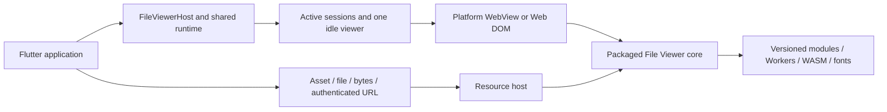

# Architecture and release gates

## Data flow

The UI component does not instantiate its own permanent server per route. An application-scoped runtime owns a resource host and session pool. A native view can attach to only one widget. Widget disposal releases its session after the frame detaches the native view. A maximum of one released session is retained; additional idle sessions are destroyed.

## Runtime states

`cold → booting → ready` describes shell and parser-module readiness. Document load events describe a particular document generation. The request bridge includes a protocol version, request identifier and document generation so stale responses cannot overwrite a newer document. A failed or terminated session is never returned to the spare pool.

`preload(source)` parses a known upcoming document in a spare session. It is optional because preloading every possible renderer consumes substantial memory and CPU. `warmUp()` reports `moduleReady` separately from `engineReady`; only measured engine initialization belongs in the latter.

Background means retaining an application-owned instance while the process lives, pausing unnecessary work, and recovering after reclamation. There is no perpetual iOS background service or unconditional Android foreground service. The plugin does not request unrelated background privileges or disable an operating-system sandbox.

## Resource host

Native targets use a loopback-only HTTP listener with a random per-runtime capability path. The listener validates Host and Origin, only accepts GET/HEAD, and serves allowlisted manifest entries and registered document identifiers. Assets have MIME types, byte counts and SHA-256 hashes. Documents support byte ranges without base64 transport over the method bridge. Disposal revokes document handles and closes the listener.

Remote authorization headers stay in Dart. Cross-origin redirects strip caller headers; HTTPS downgrades are rejected. Web uses same-origin package assets and revocable Blob URLs. Browser CORS rules apply to authenticated remote fetches.

All native targets currently use the same loopback routing. An Android `WebViewAssetLoader` optimization is a future measured optimization; it is not required or claimed by this preview. The loopback approach must pass Worker, WASM, Range and offline tests on each native engine.

## Distribution

The adapter consumes immutable public npm release archives only. Rebuilding assets does not copy files from the private File Viewer source repository. Four generated Flutter asset packages keep each pub archive below its size budget. Their package versions, upstream version and protocol must match.

Windows and Linux build scripts verify locked runtime archive hashes before extraction. A cache-only build fails if the requested archive is absent. Keep extracted engine license files in the final bundle. Linux sandbox startup and renderer-process recovery must pass on each qualified distribution; no `--no-sandbox` qualification workaround is permitted.

## Stable release gates

1. Analyze and meaningful Dart/protocol/resource-server/setup tests pass.
2. All assets rebuild reproducibly from lockfiles with license ledgers and SHA-256 manifests; pub dry-runs pass for every package.
3. Native build and real rendering checks pass for each declared platform and architecture; unsupported combinations stay explicitly unqualified.
4. PDF, DOCX, XLSX and PPTX fixtures render; required product formats additionally pass the representative upstream corpus. Confirm actual first content, not only a shell-ready event.
5. Packaged Worker and WASM execute with external runtime requests blocked. Verify range requests and fonts in each engine.
6. Route reopen, concurrent previews, theme changes, memory pressure, background/resume, logout and renderer termination pass without duplicate view attachment or stale content.
7. Record cold/warm/reopen p50 and p95, retained memory, peak memory and installed size on named devices. Performance budgets are set from measured baselines, not invented universal timing claims.
8. Verify release artifacts, dependency versions, runtime signatures/hashes, license completeness and public registry results. A passing local build does not establish a published package or six-platform support.
