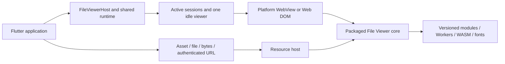

# Architecture and release gates

## Data flow

The UI component does not instantiate its own permanent server per route. An application-scoped runtime owns a resource host and session pool. A native view can attach to only one widget. Widget disposal schedules session release after the Flutter frame. On macOS, each platform-view ID owns a fresh NSView container; the retained WKWebView moves into the new container. Flutter's later disposal of the old ID therefore cannot detach the reused view. A maximum of one released session is retained; additional idle sessions are destroyed.

Windows prepares a retained composition-texture WebView through the pinned adapter's native channel. Its windowed headless controller cannot transfer into a Flutter texture, so it is not used for Windows warm-up. The first widget and subsequent attachments reuse the retained composition view and document.

## Runtime states

`cold → booting → ready` describes shell and parser-module readiness. Document load events describe a particular document generation. The request bridge includes a protocol version, request identifier and document generation so stale responses cannot overwrite a newer document. A failed or terminated session is never returned to the spare pool.

`preload(source)` parses a known upcoming document in a spare session. It is optional because preloading every possible renderer consumes substantial memory and CPU. `warmUp()` reports `moduleReady` separately from `engineReady`; only measured engine initialization belongs in the latter.

Background means retaining an application-owned instance while the process lives and pausing current audio/video playback. WebView and the OS govern other background rendering, Workers and timers; the protocol does not implement a general rendering pause. Foregrounding dispatches a resize event, while renderer termination triggers a recovery attempt. Media does not resume automatically. There is no perpetual iOS background service or unconditional Android foreground service. The plugin does not request unrelated background privileges or disable an operating-system sandbox.

## Resource host

Native targets use a loopback-only HTTP listener with a random per-runtime capability path. The listener validates Host and Origin, only accepts GET/HEAD, and serves allowlisted manifest entries and registered document identifiers. Assets have MIME types, byte counts and SHA-256 hashes. Documents support byte ranges without base64 transport over the method bridge. Disposal revokes document handles and closes the listener.

Remote authorization headers stay in Dart. Cross-origin redirects strip caller headers; HTTPS downgrades are rejected. Web uses same-origin package assets and revocable Blob URLs. Browser CORS rules apply to authenticated remote fetches.

All native targets currently use the same loopback routing. An Android `WebViewAssetLoader` optimization is a future measured optimization; it is not required or claimed by this preview. The loopback approach must pass Worker, WASM, Range and offline tests on each native engine.

## Distribution

The PPTX native viewport adapter uses the public, pinned `@file-viewer/pptx`
engine without copying or changing its parsing or drawing code. It establishes
a full-height host, registers shared core fit/zoom/view-state providers, and
keeps slideshow and pagination controls within the bounded Flutter surface.
Automatic fitting and user zoom use a single absolute scale; small surfaces
combine the engine's zoom floor with a clipped transform frame, preserving
correct scroll extents on older WebKit releases. The native
adapter reports actual slide bounds for layout consumers and qualification.

The adapter consumes immutable public npm release archives only. Rebuilding assets does not copy files from the private File Viewer source repository. Four generated Flutter asset packages keep each pub archive below its size budget. Their package versions, upstream version and protocol must match.

Copy receipts use the checked-in source epoch of the pinned upstream npm release instead of the build machine's wall clock. Their manifest hashes are recomputed after normalization. SDK inputs are restricted to version-controlled sources, excluding local IDE settings and generated plugin registrants. Tar/gzip timestamps, ownership and modes are canonicalized as well; actual qualification dates remain in the evidence reports.

Windows and Linux build scripts verify locked runtime archive hashes before extraction. A cache-only build fails if the requested archive is absent. Keep extracted engine license files in the final bundle. Linux sandbox startup and renderer-process recovery must pass on each qualified distribution; no `--no-sandbox` qualification workaround is permitted.

The Linux bundle installs CEF's `chrome-sandbox` helper as an executable beside `libcef.so`. Hosts permitting unprivileged user namespaces can use that sandbox route. Distributions restricting it require a normal privileged installer to assign the official helper root ownership and mode `4755`; the application does not change host security policy or silently elevate privileges. Linux CI prepares that helper on its disposable runner and runs the prebuilt test binary without reinstalling it.

## Stable release gates

1. Analyze and meaningful Dart/protocol/resource-server/setup tests pass.
2. All assets rebuild reproducibly from lockfiles with license ledgers and SHA-256 manifests; pub dry-runs pass for every package.
3. Native build and real rendering checks pass for each declared platform and architecture; unsupported combinations stay explicitly unqualified.
4. PDF, DOCX, XLSX and PPTX fixtures render; required product formats additionally pass the representative upstream corpus. Confirm actual first content, not only a shell-ready event.
5. Packaged Worker and WASM execute with external runtime requests blocked. Verify range requests and fonts in each engine.
6. Route reopen, concurrent previews, theme changes, memory pressure, background/resume, logout and renderer termination pass without duplicate view attachment or stale content.
7. Record cold/warm/reopen p50 and p95, retained memory, peak memory and installed size on named devices. Performance budgets are set from measured baselines, not invented universal timing claims.
8. Verify release artifacts, dependency versions, runtime signatures/hashes, license completeness and public registry results. A passing local build does not establish a published package or six-platform support.
